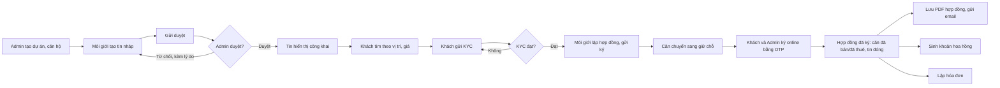

# BRD — Hệ thống quản lý bất động sản (Bds.Website)

| Thuộc tính | Nội dung |
| --- | --- |
| Loại tài liệu | Business Requirements Document (BRD) |
| Phiên bản | 0.3 — đã chốt các điểm Q-01 → Q-07 |
| Ngày | 07/10/2026 |
| Nguồn yêu cầu | [yeu_cau.pdf](yeu_cau.pdf), trang 1–2 |
| Trạng thái | Đã chốt phạm vi. Các mục ghi **[Giả định]** còn lại vẫn có thể điều chỉnh |

Quy ước nguồn của từng yêu cầu:

- **[PDF]**: bắt buộc theo đề bài.
- **[Giả định]**: nhóm đề xuất để làm rõ nghiệp vụ.
- **[Tùy chọn]**: đề bài cho phép không làm.
- **[Đã chốt]**: nhóm đã quyết định, xem mục 12.

---

## 1. Bối cảnh và vấn đề kinh doanh

Một đơn vị kinh doanh bất động sản đang phân phối căn hộ thuộc nhiều dự án, theo hình thức bán và cho thuê. Hoạt động hiện gặp các vấn đề sau:

- Thông tin dự án, căn hộ và tin rao nằm rải rác, khó kiểm soát căn nào còn trống, căn nào đã giữ chỗ hay đã bán.
- Tin rao do môi giới tự đăng không qua kiểm duyệt nên dễ sai giá hoặc sai thông tin.
- Khách hàng khó tìm căn phù hợp theo khu vực và mức giá, và phải đến trực tiếp để ký hợp đồng.
- Hoa hồng môi giới tính thủ công, dễ tranh chấp và không có lịch sử thay đổi.
- Ban quản lý không có số liệu tức thời về số tin đăng và số hợp đồng.

## 2. Mục tiêu kinh doanh

| Mã | Mục tiêu | Cách đo |
| --- | --- | --- |
| BO-01 | Quản lý tập trung dự án, căn hộ và trạng thái căn | 100% căn có trạng thái hiện tại trên hệ thống; không có căn nào được ký hai hợp đồng cùng lúc |
| BO-02 | Kiểm soát chất lượng tin rao | Chỉ tin đã duyệt mới hiển thị công khai; mọi quyết định duyệt hoặc từ chối đều có người duyệt và lý do |
| BO-03 | Rút ngắn thời gian từ lúc khách tìm căn đến lúc ký hợp đồng | Khách tự tìm căn, xác thực danh tính và ký hợp đồng trực tuyến, không cần đến văn phòng |
| BO-04 | Minh bạch hoa hồng môi giới | Mỗi hợp đồng đã ký sinh đúng một khoản hoa hồng, có cơ sở tính, tỷ lệ và lịch sử duyệt/chi |
| BO-05 | Cung cấp số liệu điều hành | Dashboard hiển thị số tin và số hợp đồng theo trạng thái và khoảng thời gian, khớp với dữ liệu gốc |

## 3. Phạm vi

### 3.1. Trong phạm vi

| Nhóm | Nội dung |
| --- | --- |
| Danh mục | CRUD dự án, căn hộ |
| Tin đăng | Đăng tin bán/cho thuê; duyệt tin |
| Tìm kiếm | Khách tìm căn hộ theo vị trí, giá |
| Giao dịch | Ký hợp đồng online; lưu hợp đồng PDF; xác thực KYC |
| Tài chính | Quản lý hoa hồng môi giới; hóa đơn (invoices) gắn hợp đồng |
| Báo cáo | Số tin, số hợp đồng; dashboard bất động sản |
| Nền tảng | Tài khoản, RBAC, nhập/xuất Excel/CSV, xuất PDF, audit log, soft-delete, versioning, thông báo, hàng đợi tác vụ |

### 3.2. Ngoài phạm vi

- Thanh toán trực tuyến, tích hợp cổng thanh toán, hóa đơn điện tử theo quy định thuế [Đã chốt].
- Thông báo in-app; hệ thống chỉ thông báo qua email [Đã chốt].
- Vai trò Manager riêng [Đã chốt].
- Chữ ký số được chứng thực bởi tổ chức CA. Ký online trong phạm vi này là ký điện tử bằng tài khoản kèm OTP.
- Ứng dụng di động riêng, bản đồ/GIS, định giá tự động, chat realtime.
- Chủ nhà tự đăng tin (marketplace), chia hoa hồng cho nhiều môi giới, quy trình vay thế chấp.
- Gia hạn, chấm dứt sớm, nhắc hạn tự động cho hợp đồng thuê; bán lại căn đã bán [Đã chốt].

## 4. Các bên liên quan và người dùng

| Bên liên quan | Vai trò trong hệ thống | Mối quan tâm chính |
| --- | --- | --- |
| Ban quản lý / Admin | **Admin** | Kiểm soát danh mục, chất lượng tin, hợp đồng, hoa hồng; có số liệu điều hành |
| Môi giới | **Môi giới** (Agent) | Đăng tin nhanh, theo dõi giao dịch và hoa hồng của mình |
| Khách hàng | **Khách hàng** (Customer) | Tìm căn phù hợp, ký hợp đồng thuận tiện, tải hợp đồng và xem hóa đơn |
| Khách vãng lai | Không đăng nhập | Xem và tìm tin công khai, đăng ký tài khoản |
| Nhà cung cấp KYC | Hệ thống bên ngoài | Nhận yêu cầu xác thực và trả kết quả |

### 4.1. Ma trận quyền ở mức nghiệp vụ

| Khả năng | Admin | Môi giới | Khách hàng | Khách vãng lai |
| --- | --- | --- | --- | --- |
| Quản lý tài khoản, vai trò, khóa tài khoản | Toàn hệ thống | Hồ sơ cá nhân | Hồ sơ cá nhân | Đăng ký |
| Dự án, căn hộ | Tạo/sửa/xóa | Xem | Xem qua tin đã duyệt | Xem qua tin đã duyệt |
| Tin đăng | Quản lý toàn bộ, duyệt/từ chối | Tạo, sửa, gửi duyệt tin của mình | Xem | Xem |
| Tìm kiếm tin công khai | Có | Có | Có | Có |
| KYC | Xem và xử lý | Chỉ xem trạng thái KYC của khách trong giao dịch mình phụ trách | Gửi và xem hồ sơ của mình | Không |
| Hợp đồng | Lập, ký đại diện đơn vị | Lập hợp đồng mình phụ trách | Xem, ký hợp đồng của mình | Không |
| Hóa đơn | Lập, ghi nhận thanh toán | Xem hóa đơn giao dịch mình phụ trách | Xem hóa đơn của mình | Không |
| Hoa hồng | Duyệt, ghi nhận đã chi | Xem hoa hồng của mình | Không | Không |
| Báo cáo, dashboard, xuất dữ liệu | Toàn hệ thống | Trong phạm vi phụ trách | Dữ liệu của mình | Không |
| Audit log | Có | Không | Không | Không |

## 5. Quy trình nghiệp vụ mong muốn

### 5.1. Luồng chính: đăng tin đến ký hợp đồng [PDF — bàn giao "flow đăng tin–ký hợp đồng"]

### 5.2. Vòng đời trạng thái
| Đối tượng | Trạng thái và chuyển đổi hợp lệ |
| --- | --- |
| Căn hộ | `Còn trống → Giữ chỗ` khi gửi hợp đồng chờ ký; `Giữ chỗ → Đã bán/Đã thuê` khi ký đủ; `Giữ chỗ → Còn trống` khi hủy hợp đồng; `Đã thuê → Còn trống` do Admin chuyển thủ công khi hết hạn thuê |
| Tin đăng | `Nháp → Chờ duyệt → Đã duyệt/Bị từ chối`; `Bị từ chối → Nháp`; `Đã duyệt → Nháp` khi sửa nội dung; `Đã duyệt → Đã đóng` |
| KYC | `Chờ xử lý → Đạt/Không đạt/Lỗi`; gửi lại tạo hồ sơ mới, giữ lịch sử cũ |
| Hợp đồng | `Nháp → Chờ ký → Đã ký`; `Nháp/Chờ ký → Đã hủy` |
| Hoa hồng | `Chờ duyệt → Đã duyệt → Đã chi`; `Chờ duyệt/Đã duyệt → Đã hủy` kèm lý do |
| Hóa đơn | `Nháp → Đã phát hành → Đã thanh toán`; `Nháp/Đã phát hành → Hủy` kèm lý do |

## 6. Yêu cầu nghiệp vụ

### 6.1. Nghiệp vụ bất động sản

| Mã | Ưu tiên | Yêu cầu | Tiêu chí chấp nhận | Nguồn |
| --- | --- | --- | --- | --- |
| BR-01 | P0 | Quản lý dự án | Admin tạo/xem/sửa/xóa mềm dự án với mã, tên, địa chỉ (tỉnh, quận, địa chỉ chi tiết), chủ đầu tư, trạng thái; không xóa dự án còn căn hộ đang hoạt động | [PDF] |
| BR-02 | P0 | Quản lý căn hộ | Căn thuộc một dự án, có mã duy nhất trong dự án, diện tích > 0, tầng/vị trí, số phòng ngủ, hướng, trạng thái; không xóa căn đang có tin hoặc hợp đồng hoạt động | [PDF] |
| BR-03 | P0 | Đăng tin bán/cho thuê | Môi giới tạo tin cho một căn còn trống, chọn loại bán hoặc cho thuê, nhập giá, tiêu đề, mô tả, ảnh; giá bán tính cho toàn căn, giá thuê tính theo tháng (VND) | [PDF] + [Giả định] |
| BR-04 | P0 | Duyệt tin | Admin duyệt hoặc từ chối tin chờ duyệt, bắt buộc nhập lý do khi từ chối; ghi lại người duyệt và thời điểm; sửa tin đã duyệt phải duyệt lại | [PDF] |
| BR-05 | P0 | Tìm căn theo vị trí, giá | Khách lọc theo tỉnh/quận, dự án, loại bán/thuê, khoảng giá, diện tích, số phòng; sắp xếp và phân trang; chỉ hiện tin đã duyệt của căn còn trống; không trộn giá bán với giá thuê trong cùng một bộ lọc giá | [PDF] |
| BR-06 | P0 | Hồ sơ khách hàng và môi giới | Mỗi khách hàng và môi giới có hồ sơ gắn với một tài khoản; hợp đồng trỏ đúng khách và môi giới phụ trách | [PDF] — customers, agents |
| BR-07 | P0 | Xác thực KYC | Khách gửi thông tin định danh; hệ thống gửi sang nhà cung cấp KYC và lưu kết quả; khách chỉ được ký hợp đồng khi KYC đạt; lỗi từ nhà cung cấp không được coi là đạt | [PDF] |
| BR-08 | P0 | Lập hợp đồng | Môi giới hoặc Admin lập hợp đồng từ tin đã duyệt, gồm loại bán/thuê, các bên, giá trị giao dịch, điều khoản, tỷ lệ hoa hồng; hợp đồng thuê có thêm ngày bắt đầu và số tháng thuê; mỗi căn tại một thời điểm chỉ có một hợp đồng chờ ký hoặc đã ký | [PDF] + [Đã chốt] |
| BR-09 | P0 | Ký hợp đồng online | Khách hàng và Admin (đại diện đơn vị, [Đã chốt]) ký bằng tài khoản đã đăng nhập kèm OTP gửi qua email; chữ ký gắn với đúng phiên bản nội dung hợp đồng; ký đủ hai bên thì hợp đồng chuyển "Đã ký"; hợp đồng đã ký không được sửa hoặc xóa | [PDF] + [Giả định] |
| BR-10 | P0 | Lưu trữ hợp đồng PDF | Sinh PDF từ nội dung phiên bản đã ký theo mẫu hợp đồng; lưu ở kho riêng tư kèm mã băm; chỉ các bên có quyền được tải | [PDF] |
| BR-11 | P0 | Quản lý hoa hồng môi giới | Khi hợp đồng ký đủ, tự sinh một khoản hoa hồng cho môi giới phụ trách; Admin duyệt và ghi nhận đã chi kèm thời điểm, tham chiếu; môi giới xem được hoa hồng của mình | [PDF] |
| BR-12 | P0 | Hóa đơn | Admin lập hóa đơn cho hợp đồng đã ký, có thể chia nhiều đợt; mã hóa đơn duy nhất, số tiền dương; ghi nhận thanh toán thủ công; xuất PDF | [PDF] — invoices + [Giả định] |
| BR-13 | P0 | Báo cáo số tin, số hợp đồng | Đếm tin và hợp đồng theo trạng thái và khoảng thời gian, theo phạm vi quyền của người xem | [PDF] |
| BR-14 | P0 | Dashboard bất động sản | Trang tổng quan gồm số tin, số hợp đồng, hợp đồng đã ký trong kỳ, tổng hoa hồng theo trạng thái, tình trạng căn theo dự án | [PDF] — bàn giao |
| BR-15 | P0 | Mẫu hợp đồng | Có mẫu hợp đồng mua bán và hợp đồng thuê dùng để sinh PDF | [PDF] — bàn giao |

### 6.2. Tính năng nền tảng

| Mã | Ưu tiên | Yêu cầu | Tiêu chí chấp nhận | Nguồn |
| --- | --- | --- | --- | --- |
| BR-20 | P0 | Đăng ký, đăng nhập, JWT | Email không trùng; mật khẩu được băm; token hết hạn bị từ chối; người tự đăng ký chỉ nhận vai trò Khách hàng | [PDF] |
| BR-21 | P0 | Đặt lại mật khẩu | Gửi liên kết qua email; token dùng một lần, có hạn; thông báo không tiết lộ email có tồn tại hay không | [PDF] |
| BR-22 | P2 | Xác thực 2 bước khi đăng nhập | Bật/tắt được; có cách khôi phục | [PDF] — tùy chọn |
| BR-23 | P0 | RBAC | Ít nhất 3 vai trò; phân quyền theo màn hình và theo hành động; API từ chối thao tác trái quyền | [PDF] |
| BR-24 | P0 | Danh sách có tìm kiếm, lọc, sắp xếp, phân trang | Áp dụng cho mọi danh sách quản trị | [PDF] |
| BR-25 | P0 | Nhập/xuất Excel/CSV | Nhập dự án và căn hộ theo mẫu, kiểm tra từng dòng và báo lỗi rõ; xuất danh sách tin, hợp đồng, hoa hồng theo quyền | [PDF] |
| BR-26 | P0 | Xuất PDF | Hợp đồng, hóa đơn, báo cáo | [PDF] |
| BR-27 | P0 | Audit log | Ghi ai làm gì, lúc nào, trên đối tượng nào cho các thao tác thay đổi dữ liệu | [PDF] |
| BR-28 | P0 | Soft-delete | Bản ghi bị xóa không hiện trong danh sách mặc định và có thể truy vết | [PDF] |
| BR-29 | P0 | Versioning bản ghi nhạy cảm | Hợp đồng, hoa hồng, hóa đơn có số phiên bản; sửa đồng thời trên phiên bản cũ bị từ chối | [PDF] |
| BR-30 | P0 | Thông báo email | Gửi email khi đặt lại mật khẩu, kết quả duyệt tin, kết quả KYC, mời ký, gửi OTP ký, hợp đồng hoàn tất | [PDF] + [Đã chốt] — chỉ dùng email |
| BR-32 | P0 | Hàng đợi tác vụ | Gửi mail, sinh PDF, xuất báo cáo chạy nền qua Hangfire; tự thử lại tối đa 3 lần; Admin xem được trạng thái job; job sinh PDF bỏ qua nếu hợp đồng đã có file | [PDF] + [Đã chốt] |

## 7. Quy tắc nghiệp vụ [Giả định]

| Mã | Quy tắc |
| --- | --- |
| RULE-01 | Tiền tệ là VND. Giá bán tính cho toàn căn, giá thuê tính theo tháng. |
| RULE-02 | Mỗi căn chỉ có tối đa một tin ở trạng thái Chờ duyệt hoặc Đã duyệt, và tối đa một hợp đồng ở trạng thái Chờ ký hoặc Đã ký. |
| RULE-03 | Một hợp đồng gắn đúng một căn, một tin, một khách hàng và một môi giới phụ trách. |
| RULE-04 | [Đã chốt] Bên bán/cho thuê là đơn vị kinh doanh, do Admin ký đại diện. Môi giới lập hợp đồng nhưng không ký. |
| RULE-05 | Khách hàng phải có KYC đạt trước khi hợp đồng được gửi ký và tại thời điểm ký. |
| RULE-06 | Nội dung hợp đồng được chốt khi gửi ký. Muốn sửa thì hủy và lập hợp đồng mới; chữ ký cũ không được dùng lại. |
| RULE-07 | OTP ký hết hạn sau 5 phút, tối đa 5 lần nhập sai, có giới hạn tần suất gửi lại. |
| RULE-08 | [Đã chốt] Hoa hồng = round(giá trị hợp đồng × tỷ lệ % / 100) VND, tỷ lệ trong khoảng 0–100. Hợp đồng bán: giá trị là giá bán. Hợp đồng thuê: giá trị = giá thuê tháng × số tháng thuê. Số tiền hoa hồng được chốt khi gửi ký. |
| RULE-09 | Khi hợp đồng ký đủ, các thay đổi sau xảy ra đồng thời hoặc không xảy ra cái nào: hợp đồng Đã ký, căn Đã bán/Đã thuê, tin Đã đóng, sinh hoa hồng. |
| RULE-10 | Hóa đơn đã phát hành không sửa nội dung; sai sót thì hủy kèm lý do và lập hóa đơn mới. Trạng thái hóa đơn không tự sinh hay thay đổi hoa hồng. |
| RULE-11 | Môi giới không xem được giấy tờ KYC gốc và hồ sơ khách ngoài giao dịch mình phụ trách. |
| RULE-12 | [Đã chốt] Hợp đồng thuê làm đơn giản: chỉ lưu ngày bắt đầu, số tháng thuê và giá thuê tháng để in vào hợp đồng và tính hoa hồng. Không gia hạn, chấm dứt sớm hay nhắc hạn. Khi hết hạn, Admin chuyển căn về Còn trống thủ công. |

## 8. Dữ liệu nghiệp vụ chính

| Thực thể | Ý nghĩa | Nguồn |
| --- | --- | --- |
| projects | Dự án bất động sản | [PDF] |
| properties | Căn hộ thuộc dự án | [PDF] |
| listings | Tin bán/cho thuê gắn với một căn | [PDF] |
| contracts | Hợp đồng mua bán/thuê, kèm phiên bản nội dung và chữ ký | [PDF] |
| customers | Hồ sơ khách hàng gắn tài khoản | [PDF] |
| agents | Hồ sơ môi giới gắn tài khoản | [PDF] |
| invoices | Hóa đơn theo đợt của hợp đồng | [PDF] |
| commissions | Khoản hoa hồng của môi giới theo hợp đồng | Suy ra từ chức năng 6 |
| kyc_verifications | Lịch sử xác thực danh tính của khách | Suy ra từ "xác thực KYC" |
| users, roles, permissions, audit_logs | Tài khoản, phân quyền, nhật ký | Suy ra từ yêu cầu chung |

## 9. Yêu cầu tích hợp

| Mã | Tích hợp | Yêu cầu nghiệp vụ | Nguồn |
| --- | --- | --- | --- |
| INT-01 | Nhà cung cấp KYC | Gửi yêu cầu, nhận kết quả qua callback đã xác thực. [Giả định] Bản demo dùng adapter giả lập và phải hiển thị rõ là "chế độ demo" | [PDF] |
| INT-02 | Kho lưu trữ tệp riêng tư | Lưu PDF hợp đồng, hóa đơn, tệp xuất; chỉ truy cập qua kiểm tra quyền | [PDF] |
| INT-03 | Email (SMTP) | Gửi thông báo và OTP; môi trường dev dùng MailHog | [PDF] — gợi ý |
| INT-04 | Thư viện tạo PDF | Sinh hợp đồng, hóa đơn, báo cáo (ví dụ QuestPDF) | [PDF] — gợi ý |

## 10. Yêu cầu phi chức năng

| Mã | Yêu cầu | Nguồn |
| --- | --- | --- |
| NFR-01 | Chống SQL injection, XSS, CSRF; rate limit; CORS chỉ cho phép nguồn đã khai báo | [PDF] |
| NFR-02 | Không lưu mật khẩu dạng thô; không ghi log mật khẩu, token, OTP, giấy tờ KYC | [Giả định] |
| NFR-03 | Cache (Redis) cho danh mục và báo cáo; làm mới cache khi dữ liệu danh mục thay đổi | [PDF] |
| NFR-04 | [Giả định] API danh sách và tìm kiếm phản hồi p95 ≤ 2 giây với ≥ 2.000 bản ghi mẫu và 20 người dùng đồng thời | [Giả định] |
| NFR-05 | Logging có cấu trúc; endpoint health check | [PDF] |
| NFR-06 | OpenAPI/Swagger đầy đủ; Postman collection cho luồng chính | [PDF] |
| NFR-07 | Unit test cho service, integration test cho API; coverage tối thiểu 30–40% (nhóm đặt mục tiêu ≥ 40%) | [PDF] |
| NFR-08 | Docker Compose gồm api, db, cache, mailhog; có hướng dẫn triển khai | [PDF] |
| NFR-09 | CI/CD đơn giản: build, test, deploy; test lỗi thì chặn deploy | [PDF] |
| NFR-10 | Seed ≥ 2.000 bản ghi dữ liệu mẫu và tài khoản demo cho cả 3 vai trò | [PDF] |
| NFR-11 | Giao diện tiếng Việt; thời gian hiển thị theo giờ Việt Nam; tiền định dạng VND | [Giả định] |

## 11. Giả định, ràng buộc và phụ thuộc

**Ràng buộc**

- Đây là bài tập lớn; thời gian và nhân lực có hạn. Phạm vi P0 phải ưu tiên hoàn thành trước.
- Công nghệ nhóm đã chọn: ASP.NET Core (`net10.0`), PostgreSQL, Docker Compose. Đề bài gợi ý FastAPI nhưng ghi rõ "tùy nhóm".
- Frontend gợi ý React.

**Phụ thuộc**

- Chưa chọn nhà cung cấp KYC thật, nên dùng adapter giả lập (INT-01).
- Ký online chỉ là ký điện tử bằng OTP email, chưa có giá trị pháp lý như chữ ký số chứng thực.

## 12. Quyết định đã chốt

| # | Câu hỏi | Quyết định | Ảnh hưởng tới tài liệu |
| --- | --- | --- | --- |
| Q-01 | Có cần vai trò Manager riêng? | Không. Dùng 3 vai trò Admin, Môi giới, Khách hàng | Mục 3.2, 4 |
| Q-02 | Ai ký đại diện bên bán/cho thuê? | Admin | BR-09, RULE-04 |
| Q-03 | Công thức hoa hồng | Một tỷ lệ % trên giá trị hợp đồng | RULE-08 |
| Q-04 | Hợp đồng thuê có kỳ hạn, gia hạn, kết thúc? | Làm đơn giản: chỉ ghi ngày bắt đầu và số tháng; không gia hạn, chấm dứt sớm hay nhắc hạn | BR-08, RULE-08, RULE-12, mục 5.2 |
| Q-05 | Hóa đơn có cần đúng chuẩn hóa đơn điện tử? | Không; chỉ là chứng từ theo dõi nội bộ | Mục 3.2, BR-12 |
| Q-06 | Kênh thông báo | Chỉ email; không làm in-app | BR-30, mục 3.2 |
| Q-07 | Cách làm hàng đợi tác vụ | Hangfire lưu job trên PostgreSQL, retry tối đa 3 lần, dashboard chỉ Admin xem | BR-32 |

## 13. Rủi ro

| Rủi ro | Mức | Biện pháp |
| --- | --- | --- |
| Phạm vi P0 rộng so với thời gian làm bài | Cao | Làm theo mốc: nền tảng → danh mục/tin → giao dịch → báo cáo/hoàn thiện; cắt P1/P2 trước |
| Hai hợp đồng cùng giữ một căn | Trung bình | Giữ căn trong giao dịch nguyên tử; có test tranh chấp đồng thời |
| Lộ dữ liệu KYC hoặc hợp đồng ngoài quyền | Cao | Kiểm tra quyền theo bản ghi ở API; kho tệp riêng tư; có test truy cập trái quyền |
| Tác vụ nền gửi mail hoặc sinh PDF thất bại | Trung bình | Hangfire tự thử lại tối đa 3 lần; Admin theo dõi job lỗi trên dashboard |
| Số liệu báo cáo sai do đếm trùng | Trung bình | Định nghĩa chỉ số rõ ràng; đối chiếu với dữ liệu gốc trong test |

## 15. Truy vết với đề bài

| Yêu cầu trong PDF | Mã trong BRD |
| --- | --- |
| CRUD dự án, căn hộ | BR-01, BR-02 |
| Đăng tin bán/cho thuê; duyệt tin | BR-03, BR-04 |
| Khách tìm căn hộ theo vị trí, giá | BR-05 |
| Ký hợp đồng online | BR-08, BR-09 |
| Báo cáo số tin, số hợp đồng | BR-13, BR-14 |
| Quản lý hoa hồng môi giới | BR-11 |
| Dữ liệu customers, agents, invoices | BR-06, BR-12, mục 8 |
| Lưu trữ hợp đồng PDF | BR-10, INT-02 |
| Xác thực KYC | BR-07, INT-01 |
| Bàn giao: flow, mẫu hợp đồng, dashboard | Mục 5.1, BR-15, BR-14 |
| Yêu cầu chung: tính năng nền tảng | BR-20 → BR-30, BR-32 |
| Yêu cầu chung: chất lượng và vận hành | NFR-01 → NFR-10 |
