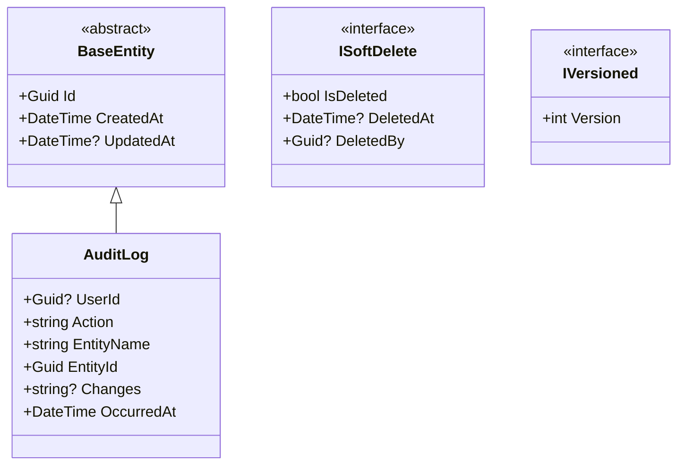
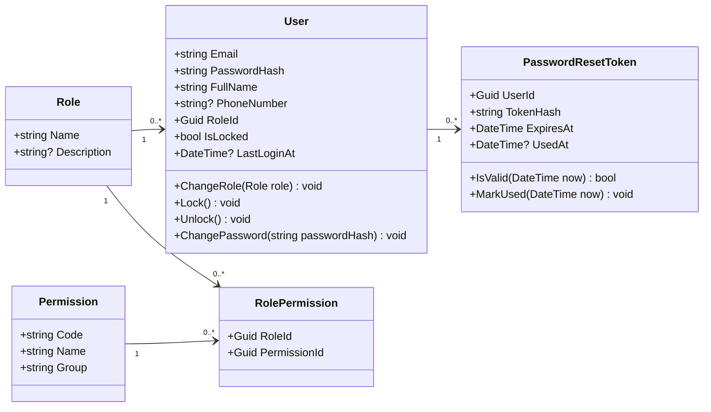
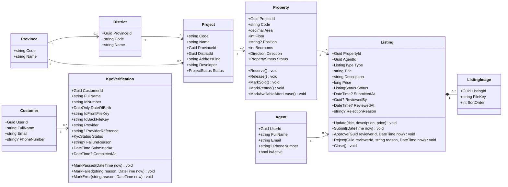
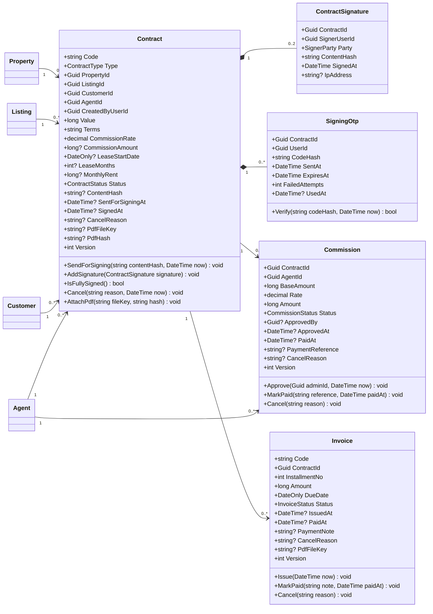
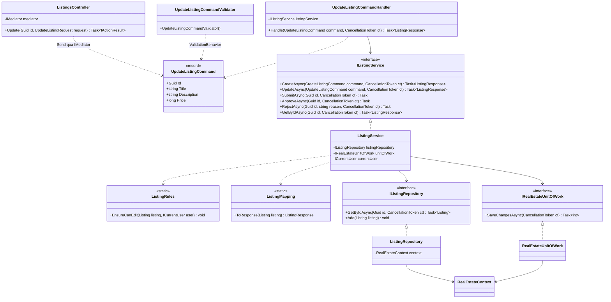

# Class Diagram — Bds.Website

Bản thiết kế dựa trên [BRD.md](BRD.md) v0.3. Code hiện chưa có entity nào; các diagram dưới đây là đề xuất để thống nhất trước khi viết Domain, Infrastructure và Service.

Quy ước chung:

- Mọi entity kế thừa `BaseEntity` (`Id` kiểu `Guid` v7, `CreatedAt`, `UpdatedAt`).
- Tiền tính bằng VND, kiểu `long`. Tỷ lệ % kiểu `decimal` (0–100).
- Các `*FileKey` là khóa tệp trong module Storage, không phải khóa ngoại.
- Phương thức trên entity là quy tắc gắn với dữ liệu của chính entity; quy tắc cần dữ liệu khác nằm trong `{Feature}Rules` hoặc service.

## 1. BuildingBlocks

| Thành phần | Mục đích | Áp dụng cho |
| --- | --- | --- |
| `ISoftDelete` | BR-28 soft-delete, lọc mặc định bằng global query filter | Project, Property, Listing, Customer, Agent |
| `IVersioned` | BR-29 versioning, cấu hình làm concurrency token | Contract, Commission, Invoice |
| `AuditLog` | BR-27, ghi tự động bằng SaveChanges interceptor | Mỗi DbContext có bảng `audit_logs` trong schema của mình, vì module không tham chiếu lẫn nhau |

`ISoftDelete`, `IVersioned`, `AuditLog` hiện **chưa có** trong BuildingBlocks.

## 2. Module Identity (schema `identity`)

- Ba vai trò seed sẵn: `Admin`, `Agent`, `Customer` (Q-01). Mỗi tài khoản có đúng một vai trò (`User.RoleId`). Người tự đăng ký chỉ nhận `Customer` (BR-20).
- `Permission.Code` dạng `listing.approve`, `contract.sign`… dùng cho RBAC theo hành động (BR-23).
- `PasswordResetToken` chỉ lưu hash, dùng một lần (BR-21).

## 3. Module RealEstate (schema `realestate`)

### 3.1. Danh mục, tin đăng, khách hàng, môi giới

### 3.2. Hợp đồng, hoa hồng, hóa đơn

### 3.3. Enum

```mermaid
classDiagram
    direction LR
    class ProjectStatus {
        <<enumeration>>
        Active
        Inactive
    }
    class PropertyStatus {
        <<enumeration>>
        Available
        Reserved
        Sold
        Rented
    }
    class Direction {
        <<enumeration>>
        North
        South
        East
        West
        NorthEast
        NorthWest
        SouthEast
        SouthWest
    }
    class ListingType {
        <<enumeration>>
        Sale
        Rent
    }
    class ListingStatus {
        <<enumeration>>
        Draft
        PendingApproval
        Approved
        Rejected
        Closed
    }
    class KycStatus {
        <<enumeration>>
        Pending
        Passed
        Failed
        Error
    }
    class ContractType {
        <<enumeration>>
        Sale
        Lease
    }
    class ContractStatus {
        <<enumeration>>
        Draft
        PendingSignature
        Signed
        Cancelled
    }
    class SignerParty {
        <<enumeration>>
        Customer
        Company
    }
    class CommissionStatus {
        <<enumeration>>
        Pending
        Approved
        Paid
        Cancelled
    }
    class InvoiceStatus {
        <<enumeration>>
        Draft
        Issued
        Paid
        Cancelled
    }
```

### 3.4. Ràng buộc chính

| Ràng buộc | Nguồn | Thực hiện |
| --- | --- | --- |
| `Property.Code` duy nhất trong một `Project` | BR-02 | Unique index (`ProjectId`, `Code`) |
| `Project.Code`, `Contract.Code`, `Invoice.Code` duy nhất | BR-01, BR-12 | Unique index |
| Mỗi căn tối đa một tin `PendingApproval`/`Approved` | RULE-02 | Partial unique index trên `PropertyId` + `ListingRules` |
| Mỗi căn tối đa một hợp đồng `PendingSignature`/`Signed` | RULE-02, BR-08 | Partial unique index trên `PropertyId` + `ContractRules` |
| Mỗi hợp đồng đúng một hoa hồng | BR-11 | Unique index trên `Commission.ContractId` |
| Khách phải có KYC `Passed` khi gửi ký và khi ký | RULE-05 | `ContractRules` kiểm tra `KycVerification` mới nhất |
| Hoa hồng = round(`Value` × `CommissionRate` / 100), chốt khi gửi ký | RULE-08 | `Contract.SendForSigning` |
| Hợp đồng thuê: `Value` = `MonthlyRent` × `LeaseMonths` | Q-04 | Validator + `Contract` |
| Ký đủ: hợp đồng `Signed`, căn `Sold`/`Rented`, tin `Closed`, sinh `Commission` | RULE-09 | Một phương thức của `ContractService`, một lần `SaveChangesAsync` |
| Chữ ký gắn đúng phiên bản nội dung | BR-09, RULE-06 | `ContractSignature.ContentHash` phải bằng `Contract.ContentHash` |
| OTP hết hạn 5 phút, tối đa 5 lần sai | RULE-07 | `SigningOtp.Verify` |
| `Customer.UserId`, `Agent.UserId` không có khóa ngoại sang `identity` | AGENTS.md | Chỉ lưu giá trị, unique index |

## 4. Luồng xử lý một use case (ví dụ cập nhật tin đăng)

| Thành phần | Project | Thư mục |
| --- | --- | --- |
| `ListingsController` | `Bds.Presentation.RealEstate` | `Controllers/v1` |
| `UpdateListingCommand`, handler, validator | `Bds.Service.RealEstate` | `UseCases/Listings/...` |
| `IListingService` / `ListingService` | `Bds.Service.RealEstate` | `Interfaces/` / `Services/` |
| `ListingRules`, `ListingMapping` | `Bds.Service.RealEstate` | `UseCases/Listings` |
| `IListingRepository` / `ListingRepository` | `Bds.Infrastructure.RealEstate` | `Interfaces/` / `Repositories/` |
| `UpdateListingRequest`, `ListingResponse` | `Bds.Model.Dto.RealEstate` | `Requests/`, `Responses/` |

`ICurrentUser` chưa có trong BuildingBlocks.

## 5. Điểm cần chốt

1. `ProjectStatus` chỉ gồm `Active`/`Inactive`, hay cần thêm giai đoạn (sắp mở bán, đang bán, đã bàn giao)?
2. `AuditLog` đặt riêng trong mỗi schema như mục 1, hay gom về một chỗ?
3. Mẫu hợp đồng (BR-15) lưu dạng tệp template trong code, không phải entity. Cần quản trị mẫu trên giao diện thì thêm entity `ContractTemplate`.
